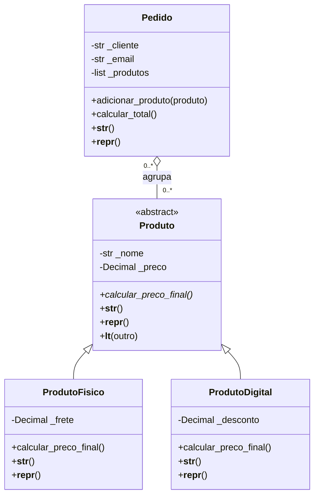

# LojaPOO — Sistema de Produtos e Pedidos

O sistema representa produtos físicos e digitais, calcula seus preços finais e organiza os produtos em pedidos.

## Funcionalidades

- Modelagem com quatro classes, incluindo uma classe abstrata.
- Validação de atributos por meio de propriedades.
- Herança com reaproveitamento do construtor usando `super()`.
- Cálculo polimórfico dos preços finais.
- Organização de produtos em pedidos.
- Ordenação dos produtos pelo preço final.
- Tratamento de entradas inválidas.
- Demonstração com dez produtos e um pedido.
- Quinze testes automatizados.

## Tecnologias utilizadas

- Python 3.9 ou superior.
- `abc`: definição da classe abstrata.
- `decimal`: cálculos monetários.
- `re`: validação do formato de e-mail.
- `unittest`: testes automatizados.

O projeto utiliza apenas bibliotecas padrão do Python, sem necessidade de instalar dependências externas.

## Estrutura do projeto

| Arquivo | Finalidade |
| --- | --- |
| `modelos.py` | Classes, propriedades e regras de negócio |
| `main.py` | Demonstração do funcionamento |
| `test_modelos.py` | Testes automatizados |
| `saida_exemplo.txt` | Saída completa da demonstração |
| `README.md` | Documentação do projeto |

Mantenha todos os arquivos na mesma pasta.

## Como executar

Com o Python instalado, abra o terminal na pasta do projeto e execute:

```bash
python main.py
```

A demonstração é automática e não exige digitação de dados.

Para executar os testes:

```bash
python -m unittest -v
```

Se o seu sistema utilizar o comando `python3`, substitua `python` por `python3`.

## Diagrama de classes



## Modelagem das classes

### Produto

Classe abstrata que concentra os atributos e comportamentos comuns aos produtos.

Utiliza `ABC` e define `calcular_preco_final()` com `@abstractmethod`. Dessa forma, não pode ser instanciada diretamente, e suas subclasses devem implementar o cálculo do preço final.

### ProdutoFisico

Representa um produto físico, acrescentando um frete unitário ao preço base.

```text
Preço final = preço base + frete
```

### ProdutoDigital

Representa um produto digital, aplicando um desconto percentual ao preço base.

```text
Preço final = preço base × (1 − desconto / 100)
```

### Pedido

Agrupa produtos e calcula o total por meio da soma dos preços finais.

Cada inclusão representa uma unidade. Adicionar o mesmo produto novamente representa outra unidade no pedido.

## Herança e composição de objetos

A herança é utilizada porque um `ProdutoFisico` **é um** `Produto`, assim como um `ProdutoDigital`.

As subclasses chamam `super().__init__(nome, preco)` para reaproveitar a inicialização e as validações da classe mãe.

Um `Pedido`, por sua vez, **tem produtos**, mas não é um produto. Portanto, utiliza uma coleção de objetos em vez de herança.

No diagrama UML, essa relação é uma **agregação**: os produtos existem independentemente dos pedidos e podem ser compartilhados entre eles.

O pedido copia a coleção recebida, mas mantém referências aos produtos. Assim, alterar validamente o preço de um produto também altera o total dos pedidos que o utilizam.

## Encapsulamento com propriedades

Os atributos são acessados por propriedades definidas com `@property`. Os setters verificam os dados antes de modificar o estado do objeto.

| Propriedade | Validação |
| --- | --- |
| `nome` | Deve ser um texto não vazio |
| `preco` | Deve ser um valor finito entre 0 e 1 bilhão |
| `frete` | Deve ser um valor finito entre 0 e 1 bilhão |
| `desconto` | Deve estar entre 0 e 100 |
| `cliente` | Deve ser um texto não vazio |
| `email` | Deve apresentar um formato simplificado de e-mail válido |
| `produtos` | Retorna uma tupla; a inclusão ocorre pelo método validado |

Os construtores também utilizam essas propriedades, aplicando as validações desde a criação dos objetos.

Se uma alteração for rejeitada, o valor anterior permanece preservado:

```python
from modelos import ProdutoFisico

produto = ProdutoFisico("Livro", "50.00", "8.00")

try:
    produto.preco = -10
except ValueError as erro:
    print(f"Alteração rejeitada: {erro}")

print(produto.preco)  # 50.00
```

Os atributos internos utilizam o prefixo `_`, conforme a convenção de encapsulamento do Python. A interface suportada é formada pelas propriedades e pelos métodos públicos.

## Polimorfismo

Objetos de classes diferentes respondem à mesma chamada de método, utilizando suas próprias regras.

```python
from modelos import ProdutoDigital, ProdutoFisico

produtos = [
    ProdutoFisico("Livro", "100.00", "10.00"),
    ProdutoDigital("Curso Python", "100.00", "10"),
]

for produto in produtos:
    print(f"{produto.nome}: R$ {produto.calcular_preco_final():.2f}")
```

Saída:

```text
Livro: R$ 110.00
Curso Python: R$ 90.00
```

O método `Pedido.calcular_total()` utiliza esse mesmo princípio, sem precisar identificar a classe concreta de cada produto.

## Métodos especiais

Todas as quatro classes de domínio possuem implementação explícita de `__init__`, `__str__` e `__repr__`.

| Método | Responsabilidade |
| --- | --- |
| `__init__` | Inicializa e valida os atributos |
| `__str__` | Apresenta uma descrição amigável do objeto |
| `__repr__` | Apresenta informações técnicas para inspeção |
| `__lt__` | Permite ordenar produtos pelo preço final |

O método `__lt__` é implementado na classe `Produto` e herdado pelas subclasses:

```python
for produto in sorted(produtos):
    print(produto)
```

O método `__eq__` não foi sobrescrito. Produtos distintos mantêm identidades diferentes, mesmo que tenham nomes e preços iguais.

## Exemplo de pedido

```python
from modelos import Pedido, ProdutoDigital, ProdutoFisico

livro = ProdutoFisico("Livro", "50.00", "8.00")
curso = ProdutoDigital("Curso Python", "200.00", "10")

pedido = Pedido(
    cliente="Cliente Exemplo",
    email="cliente@example.com",
    produtos=[livro, curso],
)

print(pedido)
```

Saída:

```text
Pedido de Cliente Exemplo | 2 item(ns) | total: R$ 238.00
```

## Tratamento de exceções

O programa trata erros de entrada com `try/except`.

| Exceção | Exemplo de situação |
| --- | --- |
| `ValueError` | Preço negativo, desconto acima de 100 ou e-mail inválido |
| `TypeError` | Tipo incompatível ou tentativa de adicionar um item que não é produto |

A demonstração inclui tentativas inválidas de alteração de preço, frete, desconto, e-mail e cliente, além de construção e inclusão de objetos inválidos.

## Precisão dos valores monetários

Os cálculos utilizam `Decimal`.

Preço, frete e resultado do desconto são arredondados para duas casas decimais com `ROUND_HALF_UP`.

Para valores textuais, utilize ponto como separador decimal:

```python
produto = ProdutoFisico("Caderno", "19.90", "5.00")
```

Valores negativos, infinitos, `NaN` e booleanos são rejeitados nos campos numéricos.

## Demonstração e testes

O arquivo `main.py` cria:

- Cinco produtos físicos.
- Cinco produtos digitais.
- Um pedido contendo os dez produtos.

O pedido de demonstração totaliza **R$ 625,00**. Esse valor permanece inalterado após as tentativas de atualização com dados inválidos.

Os quinze testes verificam:

- Restrição de instanciação da classe abstrata.
- Herança e criação de dez produtos distintos.
- Polimorfismo e cálculo do total.
- Validações nos construtores e setters.
- Preservação dos valores após alterações inválidas.
- Limites de desconto e arredondamento monetário.
- Proteção da coleção de produtos.
- Independência entre pedidos.
- Ordenação e representação dos objetos.

Todos os quinze testes passaram na verificação da entrega.

## Limitações do projeto

- Os dados são mantidos somente em memória.
- Não há banco de dados, interface gráfica ou integração com pagamentos.
- O frete é calculado por unidade de produto.
- O e-mail é validado apenas pelo formato.
- Os pedidos não congelam os preços dos produtos.
- A tupla protege a coleção, mas os produtos continuam editáveis por suas propriedades.

## Objetivo acadêmico

Demonstrar a aplicação dos principais conceitos de Programação Orientada a Objetos em um sistema organizado, com responsabilidades definidas, validações, testes e documentação.